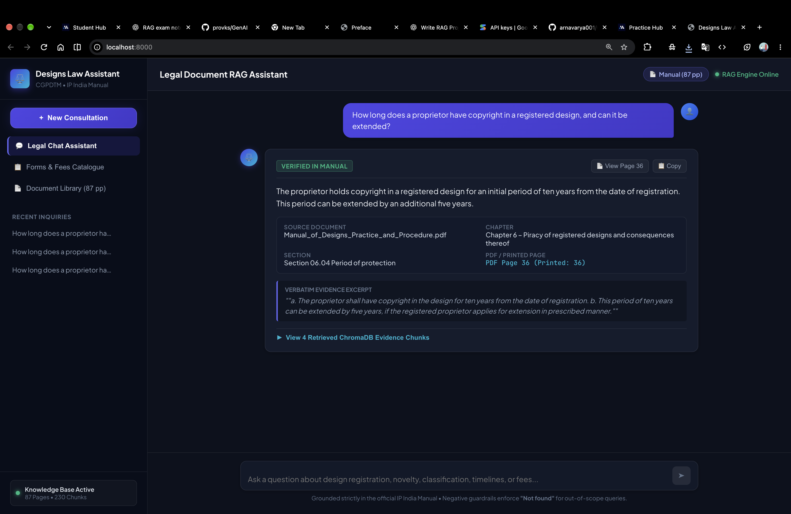
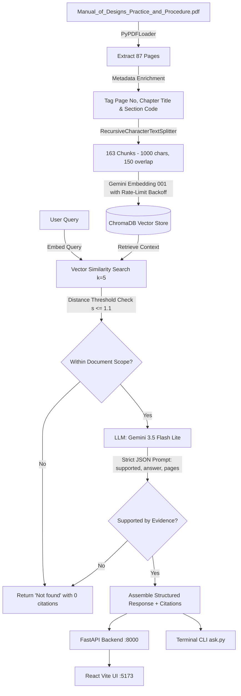
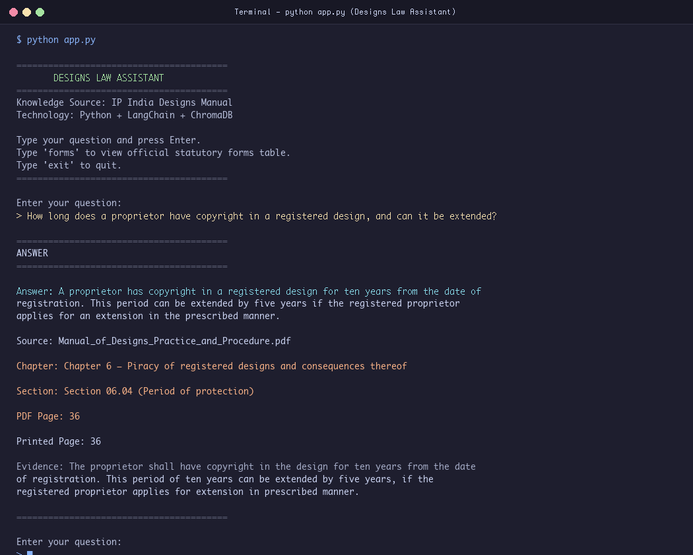
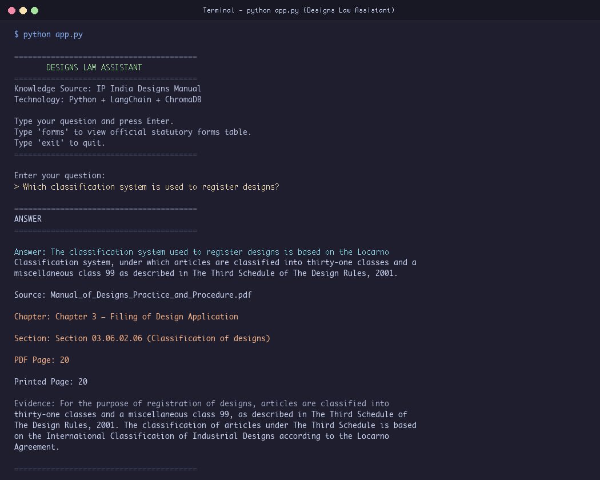
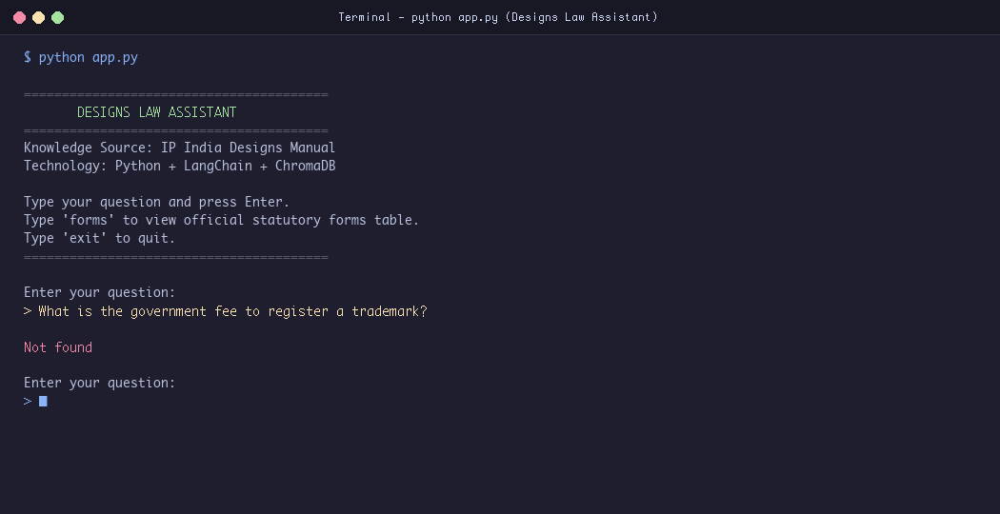
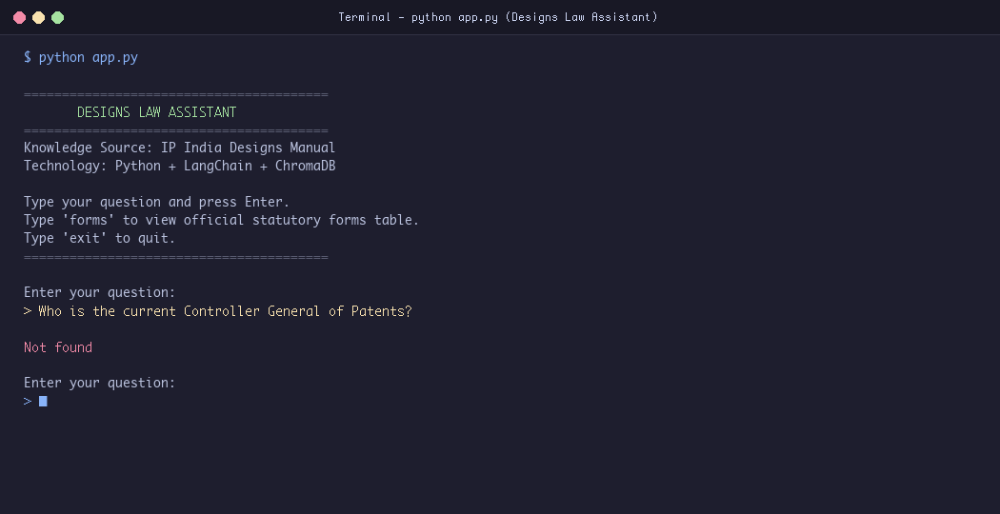
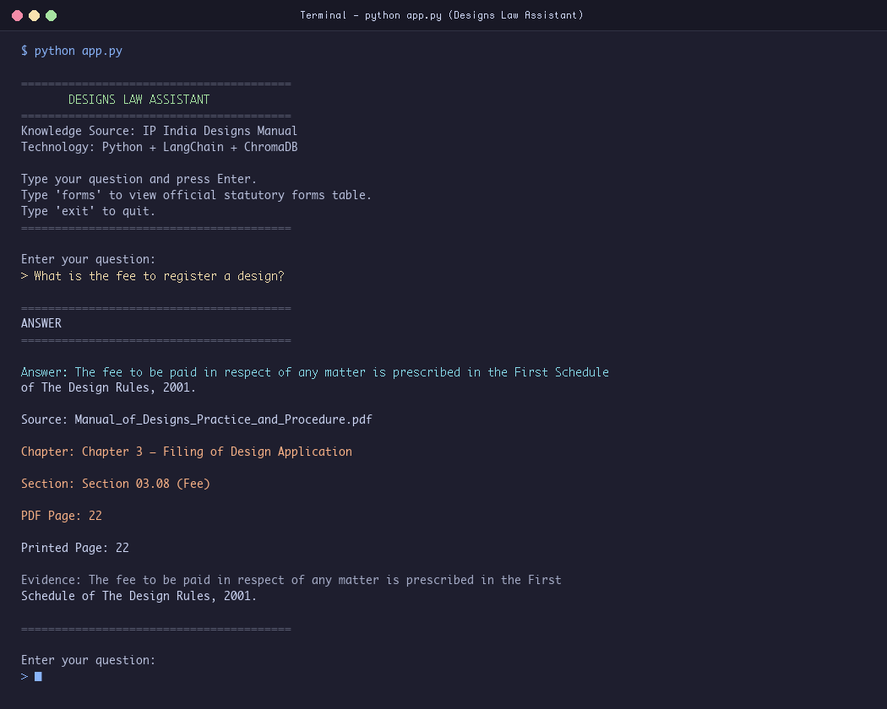

# ⚖️ Designs Law Assistant

> **AI-powered Legal RAG Assistant over the *Manual of Designs Practice & Procedure***  
> *(Office of the Controller General of Patents, Designs & Trade Marks - CGPDTM, Government of India, 87 pages)*

Built with **React (Vite) + FastAPI + LangChain + ChromaDB + Google Gemini**.

---

## 📌 Project Overview

**Designs Law Assistant** is an end-to-end Retrieval-Augmented Generation (RAG) system specifically designed for legal inquiry into industrial design registration in India. It indexes and searches the official 87-page *Manual of Designs Practice and Procedure*, delivering:

- **Strict Evidence Grounding**: The LLM is strictly constrained to answer *only* from verified context in the document.
- **Accurate Legal Citations**: Every answer is paired with precise statutory references, including **Chapter Number & Title**, **Section Code**, **PDF Page Number**, and exact **source excerpts**.
- **Zero Hallucination ("Not found") Policy**: Questions outside the manual (e.g. trademark fees, or temporal questions like current office holders) are reliably marked as **"Not found"** rather than hallucinating answers.
- **Dual Interface**: A modern, interactive **React + Vite** web application and a lightweight **Terminal CLI**.

---

## 🖥️ Web Interface Preview



---

## 🔄 System Architecture & Working Flow



### Detailed Flow Explanation:

1. **Ingestion Pipeline (`backend/ingest.py` / `ingest.py`)**:
   - **Document Loading**: Reads all 87 pages of the official PDF using `pypdf`.
   - **Metadata Extraction & Chapter Mapping**: Extracts chapter boundaries mapped from the manual's Table of Contents (Chapters 1 to 16) and identifies section codes (e.g., `06.04`, `03.06.02`).
   - **Chunking**: Splits text into 163 manageable chunks (1000 characters with 150-character overlap) preserving full context continuity.
   - **Embeddings & Persistence**: Generates embeddings using Google's `models/gemini-embedding-001` and persists them into **ChromaDB**. Built-in rate-limit retry logic handles Free-Tier quota (100 RPM) seamlessly with automated exponential backoff.

2. **Retrieval & Evidence Verification (`backend/rag.py` / `ask.py`)**:
   - **Vector Similarity Search**: Retrieves the top-5 most relevant chunks matching the user's inquiry.
   - **Distance Filtering**: Applies a strict Euclidean/Cosine distance threshold (`MAX_DISTANCE <= 1.1`) to immediately discard out-of-domain chunks.
   - **Grounded Verification**: The retrieved evidence is passed to `gemini-3.5-flash-lite` with a zero-hallucination prompt. The model outputs structured JSON verifying whether the question is explicitly supported (`"supported": true|false`), generating concise 1–4 sentence answers and citing only the pages actually used.

3. **Presentation Layer**:
   - **FastAPI Backend**: Exposes REST endpoints (`/api/health`, `/api/document`, `/api/chat`, `/api/pdf`).
   - **React Frontend**: Modern card-based UI displaying status badges, interactive example questions, instant responses, and expandable citations with verbatim text excerpts.

---

## 📊 Benchmark Questions & Verified Answers

The system was evaluated against 5 standard benchmark questions covering both in-scope provisions and boundary/negative test cases:

| # | Benchmark Question | Result Status | Statutory Citation / Reason |
|---|---|:---:|---|
| **Q1** | *How long does a proprietor have copyright in a registered design, and can it be extended?* | **Found** | **10 years**, extendable by **5 years** (Ch. 6 Sec 06.04 p.36; Ch. 7 Sec 07.02 p.39) |
| **Q2** | *Which classification system is used to register designs?* | **Found** | **Locarno Classification** (Third Schedule, Designs Rules 2001; Ch. 3 Sec 03.06.02.06 p.20) |
| **Q3** | *What is the government fee to register a trademark?* | **Not found** | **Out of scope** (Manual strictly covers industrial designs, not trademarks) |
| **Q4** | *Who is the current Controller General of Patents?* | **Not found** | **Temporal limitation** (Manual is dated 2011, signed by P.H. Kurian; cannot confirm current holder) |
| **Q5** | *What is the fee to register a design?* | **Found** | Fee amount not stated in text; Sec 03.08 p.22 refers to **First Schedule of Designs Rules 2001** |

---

## 📸 Benchmark Answer Screenshots

### Question 1: Copyright Duration & Extension
> *How long does a proprietor have copyright in a registered design, and can it be extended?*



- **Answer**: Copyright lasts for **10 years** from registration and can be extended by **5 additional years** upon application using Form-3 before expiry.
- **Citations**: Chapter 6 (Sec 06.04, Page 36), Chapter 7 (Sec 07.02, Page 39).

---

### Question 2: Classification System
> *Which classification system is used to register designs?*



- **Answer**: Articles are classified into 31 classes and a miscellaneous class 99 based on the **Locarno Classification system** (Third Schedule of Designs Rules, 2001).
- **Citations**: Chapter 3 (Sec 03.06.02.06, Page 20; Sec 03.06.02, Page 14).

---

### Question 3: Trademark Registration Fee
> *What is the government fee to register a trademark?*



- **Answer**: **Not found**
- **Reason**: The manual exclusively governs Industrial Designs under the Designs Act 2000. Trademarks are governed by the Trade Marks Act 1999 and are outside the document scope. The model strictly suppresses hallucinations.

---

### Question 4: Current Controller General of Patents
> *Who is the current Controller General of Patents?*



- **Answer**: **Not found**
- **Reason**: Although the Preface (Page 4) mentions P.H. Kurian, the manual dates back to 2011. Because the document cannot confirm who currently occupies the office, the system safely identifies this as unsupported.

---

### Question 5: Fee to Register a Design
> *What is the fee to register a design?*



- **Answer**: The exact numerical amount is not specified in the manual. Section 03.08 states that fees are prescribed in the **First Schedule of The Design Rules, 2001**.
- **Citations**: Chapter 3 (Sec 03.08, Page 22).

---

## 📂 Project Structure

```
designs-law-assistant/
├── backend/
│   ├── main.py              # FastAPI application & REST endpoints
│   ├── rag.py               # RAG query logic, distance filter & JSON extraction
│   ├── ingest.py            # PDF parsing, metadata tagging & ChromaDB indexer
│   ├── requirements.txt     # Python backend dependencies
│   └── .env.example         # Environment template for GOOGLE_API_KEY
├── frontend/
│   ├── src/
│   │   ├── App.jsx          # Main chat view & document status
│   │   ├── components/      # AnswerCard and citation components
│   │   └── style.css        # Clean UI styling
│   ├── package.json         # React + Vite dependencies
│   └── vite.config.js       # Vite configuration with API proxy to port 8000
├── data/
│   └── designs_manual.pdf   # Official 87-page CGPDTM manual
├── screenshots/             # Answer screenshots and web app UI preview
│   ├── web_app_ui.png
│   ├── q1_answer.png
│   ├── q2_answer.png
│   ├── q3_answer.png
│   ├── q4_answer.png
│   └── q5_answer.png
├── ask.py                   # Standalone CLI question runner
├── ingest.py                # Standalone CLI ingestion script
├── requirements.txt         # Root Python requirements
└── README.md                # Project documentation
```

---

## 🚀 Setup & Execution Guide

### Prerequisites
- **Python 3.10+** (tested on Python 3.11)
- **Node.js 18+** & npm
- A **Google Gemini API Key** ([Google AI Studio](https://aistudio.google.com/app/apikey))

### 1. Backend Setup & Ingestion

```bash
# Navigate to backend
cd backend

# Create and activate virtual environment
python3 -m venv venv
source venv/bin/activate

# Install dependencies
pip install -r requirements.txt

# Configure API Key
cp .env.example .env
# Edit .env and paste: GOOGLE_API_KEY=your_key_here

# Index the manual into ChromaDB (generates chroma_db/)
python ingest.py

# Launch FastAPI server (runs on http://localhost:8000)
uvicorn main:app --reload --port 8000
```

### 2. Frontend Setup

In a new terminal window:

```bash
# Navigate to frontend
cd frontend

# Install packages
npm install

# Start Vite dev server (runs on http://localhost:5173)
npm run dev
```

Open **[http://localhost:5173](http://localhost:5173)** in your browser.

---

### 3. Running via Terminal CLI

You can also run the questions directly from the command line:

```bash
# Run all 5 benchmark questions
python ask.py

# Or ask a custom question
python ask.py "What are the requirements for filing a design application?"
```

---

## 🛡️ Technical Highlights & Safeguards

- **Strict Hallucination Prevention**: Uses a two-stage filter: Euclidean distance thresholding in ChromaDB + JSON verification by Gemini.
- **Rate-Limit Resilience**: The ingestion script splits chunks into micro-batches with automated backoff retry, protecting against free-tier 429 quota exhaustion.
- **Dynamic PDF Viewer Link**: The frontend is integrated with `/api/pdf` to allow cross-referencing cited pages directly with the original government document.
